# 🌐 Awesome Distributed Coordination & Consensus Ecosystem

<p align="center">
  
</p>

<p align="center">
  <a href="https://github.com/ishandutta2007/Awesome-Awesome-Awesome"></a>
  <a href="https://discord.gg/jc4xtF58Ve"></a>
  <a href="https://github.com/ishandutta2007/Awesome-Distributed-Coordination/stargazers"></a>
  <a href="https://github.com/ishandutta2007/Awesome-Distributed-Coordination/network/members"></a>
  <a href="https://github.com/ishandutta2007/Awesome-Distributed-Coordination/blob/main/LICENSE"></a>
  <a href="https://github.com/ishandutta2007"></a>
</p>

---

## 🧭 Overview & Architecture Focus

Welcome to **Awesome Distributed Coordination** — the definitive curated directory and architectural reference guide for **distributed consensus protocols**, **dynamic service discovery**, **distributed configuration stores**, **distributed locking primitives (e.g. Redlock)**, and **cluster membership coordination**. 

In high-scale microservices, Kubernetes clusters, and multi-datacenter cloud infrastructures, distributed coordination frameworks serve as the single source of truth for:
* ⚡ **Leader Election & Consensus**: Raft, Paxos, ZAB, and Byzantine Fault Tolerant (BFT) state machine replication.
* 🌐 **Dynamic Service Discovery & Registration**: Real-time service registries, health monitoring, DNS-driven resolutions, and dynamic routing topologies.
* 🔒 **Distributed Mutual Exclusion & Locks**: High-performance fencing tokens, ephemeral leases, distributed semaphores, and barriers.
* 📦 **Dynamic Configuration & Feature Flags**: Zero-downtime runtime configuration updates, gradual rollouts, and schema validation.

> 💡 **Open-Source & Cloud Infrastructure**: Whether designing resilient SRE platform architecture, deploying multi-region service meshes, or self-hosting consensus clusters, this guide provides side-by-side comparisons of market-leading managed SaaS solutions and high-performance open-source GitHub projects.

---

## 📑 Table of Contents

- [📊 Sector Overview & Market Dynamics](#-sector-overview--market-dynamics)
- [☁️ SaaS / Managed Hosted Platforms](#️-saas--managed-hosted-platforms)
- [🔓 Open-Source GitHub Projects (Ranked by Stars)](#-open-source-github-projects-ranked-by-stars)
- [🧩 Architecture Patterns & Selection Guide](#-architecture-patterns--selection-guide)
- [📈 Star History](#--star-history)
- [🤝 How to Contribute](#-how-to-contribute)
- [💖 Support & Sponsorship](#-support--sponsorship)
- [📜 Disclaimer](#-disclaimer)

---

## 📊 Sector Overview & Market Dynamics

The global market for **Distributed Coordination and Service Discovery Software** is currently valued at approximately **$2.5 billion**, projected to scale past **$7.8 billion** by 2032 with a compound annual growth rate (**CAGR of ~15.5%**). Simultaneously, the broader **Microservices Orchestration and Control Plane** market is expanding rapidly from **$4.4 billion to over $40 billion** (>22% CAGR), propelled by containerization, hybrid-cloud federation, and autonomous microservices workloads.

### 🔍 Market Structure: Concentrated & Bifurcated
The industry landscape demonstrates a unique **bifurcated concentration**:
1. **Hyperscalers & Enterprise Standard Bearers**: Cloud titans (**Google Cloud, Microsoft Azure, AWS**) offer deeply integrated managed configuration and metadata layers, while infrastructure powerhouses (**IBM/HashiCorp**, **Redis Inc.**) monetize enterprise control planes and clustering suites.
2. **Open-Source Protocol Hegemony**: Foundational coordination primitives remain heavily anchored by open-source industry backbones (**etcd** as the heartbeat of Kubernetes, **CoreDNS** as the DNS resolver, and **Apache ZooKeeper** across enterprise big data).
3. **Emerging Frontiers**: High-throughput distributed caching/KV engines (**Dragonfly**, **Valkey**) and application runtime coordination layers (**Dapr**, **Nacos**, **TiKV**) are rapidly gaining enterprise adoption to avoid vendor lock-in and lower p99 latency overheads.

---

## ☁️ SaaS / Managed Hosted Platforms

The following enterprise cloud platforms deliver fully managed coordination, dynamic runtime configuration, and high-availability service registry capabilities.

| Company / Parent | Valuation / Revenue | Product / Platform | Primary Focus | Pricing (Paid Tiers) | Free Tier Limits / Free Trial |
| :--- | :--- | :--- | :--- | :--- | :--- |
| **Alphabet (Google)** | ~$4.15T Market Cap ($350B+ Revenue) | **Google Cloud Runtime Configuration** | Centralized metadata, hierarchical configuration, and synchronization primitives | Pay-as-you-go infrastructure / API usage; no direct standalone fee per variable | 90-day free trial with $300 cloud credits for new accounts; max 4 MB data per config resource |
| **Microsoft** | ~$3.95T Market Cap ($245B+ Revenue) | **Azure App Configuration** | Managed dynamic configuration, feature flags, and instant rollout control | Standard tier starts at **$1.20/store/day** (~$36/month per store) including 200,000 requests/day ($0.06 per 10k overage) | Free forever plan: 1 store per subscription, 10 MB storage, and up to 1,000 requests/day (7-day history) |
| **Amazon (AWS)** | ~$2.80T Market Cap ($620B+ Revenue) | **AWS AppConfig** | Dynamic configuration deployment, validation, and gradual rollout management | Pay-as-you-go: **$0.20 per 1M configuration requests** ($0.0000002/req) + **$800 per 1M configurations received** ($0.0008/recv) | No standalone perpetual free tier; covered under AWS Free Plan ($100–$200 promotional credits over 6–12 months for new accounts) |
| **IBM (HashiCorp)** | ~$220B Market Cap ($6.4B Acquisition / $600M+ ARR) | **HashiCorp Cloud Platform (HCP) Consul** | Fully managed service discovery, service mesh, and distributed key-value store | Development clusters start at **$0.61/hour** (~$440/month); Production Standard clusters start at **$1.50/hour** (~$1,080/month) | No perpetual free tier; 30-day free platform trial with **$500 HCP credits** for new accounts |
| **Redis** | ~$2.0B Valuation ($300M+ ARR) | **Redis Enterprise Cloud** | Distributed locks (Redlock), high-throughput coordination, and in-memory key-value data | Paid fixed tiers start at **$5.00/month** (250MB storage); flexible pay-as-you-go plans start at **$0.0125/hour** (~$9/month) | Free forever plan: 1 database with **30 MB storage**, up to 30 concurrent client connections |

*(Note: Internal systems like Google Chubby remain seminal architectural benchmarks but are closed proprietary technologies).*

---

## 🔓 Open-Source GitHub Projects (Ranked by Stars)

A comprehensive, rigorously vetted catalog of open-source distributed coordination platforms, Raft/Paxos consensus implementations, and service discovery backbones.

> Repositories are strictly sorted in descending order by **GitHub_Stars_Count**. Each Stars_Badge links directly to the project's stargazers community.

### 1. [Redis](https://github.com/redis/redis) [](https://github.com/redis/redis/stargazers)
* **Primary Focus**: In-memory data store, distributed locking, pub/sub, and ephemeral coordination primitives.
* **Consensus / Consistency**: Asynchronous replication (Eventual Consistency) with Redlock algorithm for distributed mutual exclusion.
* **License**: Redis Source Available License (RSALv2) / SSPL.
* **Key Features**: Microsecond latency, versatile data structures (Hashes, Sorted Sets, Streams), pub/sub messaging, and distributed locks via Redlock-lite recipes.

### 2. [etcd](https://github.com/etcd-io/etcd) [](https://github.com/etcd-io/etcd/stargazers)
* **Primary Focus**: Strongly consistent distributed key-value store powering Kubernetes control plane state.
* **Consensus / Consistency**: Raft Consensus Algorithm (Strict Linearizable Reads/Writes).
* **License**: Apache-2.0.
* **Key Features**: Key change watch streams, lease-based TTL expiration, distributed software transactions, RBAC, snapshot restore, and CNCF Graduated project status.

### 3. [Nacos (Alibaba)](https://github.com/alibaba/nacos) [](https://github.com/alibaba/nacos/stargazers)
* **Primary Focus**: Dynamic service discovery, configuration management, and service metadata governance.
* **Consensus / Consistency**: Hybrid architecture (Distro protocol for AP mode, Raft for CP metadata).
* **License**: Apache-2.0.
* **Key Features**: Dynamic configuration push, weighted routing, health checks, multi-tier cache, and native integration with Spring Cloud and Dubbo ecosystems.

### 4. [Dragonfly](https://github.com/dragonflydb/dragonfly) [](https://github.com/dragonflydb/dragonfly/stargazers)
* **Primary Focus**: Ultra-high-throughput multi-threaded in-memory datastore and coordination cache.
* **Consensus / Consistency**: Multi-threaded share-nothing architecture with lock-free coordination algorithms.
* **License**: Business Source License (BSL 1.1).
* **Key Features**: Fully compatible with Redis & Memcached APIs, 25x throughput over standard single-threaded Redis, and low-latency locking primitives.

### 5. [HashiCorp Consul](https://github.com/hashicorp/consul) [](https://github.com/hashicorp/consul/stargazers)
* **Primary Focus**: Multi-cloud service discovery, distributed KV storage, and service mesh orchestration.
* **Consensus / Consistency**: Raft protocol for consensus + Serf (gossip protocol) for cluster membership and health.
* **License**: Business Source License (BSL 1.1).
* **Key Features**: DNS and HTTP API discovery interfaces, active health checking, intentions-based mTLS security, and cross-datacenter WAN federation.

### 6. [Valkey](https://github.com/valkey-io/valkey) [](https://github.com/valkey-io/valkey/stargazers)
* **Primary Focus**: Community-driven, purely open-source in-memory key-value data structure and coordination engine.
* **Consensus / Consistency**: High-speed master-replica asynchronous replication and cluster partitioning.
* **License**: BSD-3-Clause (Linux Foundation).
* **Key Features**: Drop-in open-source fork of Redis created by the community and cloud providers; ideal for high-throughput locking and leader election.

### 7. [Dapr](https://github.com/dapr/dapr) [](https://github.com/dapr/dapr/stargazers)
* **Primary Focus**: Distributed Application Runtime providing distributed lock and state coordination APIs.
* **Consensus / Consistency**: Pluggable backend coordination providers (etcd, Redis, Zookeeper, Cloud KV).
* **License**: Apache-2.0.
* **Key Features**: Polyglot sidecar architecture providing building blocks for distributed locks, pub/sub, service invocation, and workflow orchestration.

### 8. [TiKV](https://github.com/tikv/tikv) [](https://github.com/tikv/tikv/stargazers)
* **Primary Focus**: Distributed transactional key-value database built in Rust.
* **Consensus / Consistency**: Multi-Raft Consensus protocol with ACID transactions.
* **License**: Apache-2.0.
* **Key Features**: Horizontal scalability across petabytes of data, CNCF Graduated project, linearizable distributed reads/writes, and strong consistency.

### 9. [CoreDNS](https://github.com/coredns/coredns) [](https://github.com/coredns/coredns/stargazers)
* **Primary Focus**: Fast and flexible DNS-based service discovery for cloud-native infrastructure.
* **Consensus / Consistency**: Plugin-chained DNS resolution integrating directly with Kubernetes etcd.
* **License**: Apache-2.0.
* **Key Features**: Default service registry/DNS engine for Kubernetes, extensible Go plugin pipeline, integrated Prometheus metrics, and split-horizon DNS.

### 10. [Apache ZooKeeper](https://github.com/apache/zookeeper) [](https://github.com/apache/zookeeper/stargazers)
* **Primary Focus**: Battle-tested centralized service for configuration, distributed locks, naming, and group services.
* **Consensus / Consistency**: ZooKeeper Atomic Broadcast (ZAB) protocol (Strict Sequential Consistency).
* **License**: Apache-2.0.
* **Key Features**: Hierarchical namespace (znodes), ephemeral and sequential nodes for election recipes, watches, and Prometheus observability metrics.

### 11. [Eureka (Netflix)](https://github.com/Netflix/eureka) [](https://github.com/Netflix/eureka/stargazers)
* **Primary Focus**: Tier-2 service discovery and registry built for AWS mid-tier load balancing and failover.
* **Consensus / Consistency**: AP system (Eventual Consistency prioritizing availability over immediate consistency).
* **License**: Apache-2.0.
* **Key Features**: Client-side load balancing, self-preservation mode during network partitions, and native Spring Cloud Netflix integration.

### 12. [Patroni](https://github.com/zalando/patroni) [](https://github.com/zalando/patroni/stargazers)
* **Primary Focus**: High Availability and consensus coordinator template for PostgreSQL clusters.
* **Consensus / Consistency**: Delegates quorum and leader elections to DCS backends (etcd, Consul, ZooKeeper).
* **License**: MIT.
* **Key Features**: Automated failover, split-brain protection, dynamic reconfiguration, and deep PostgreSQL streaming replication hooks.

### 13. [Hazelcast](https://github.com/hazelcast/hazelcast) [](https://github.com/hazelcast/hazelcast/stargazers)
* **Primary Focus**: In-memory computing platform and distributed data grid with Raft CP subsystem.
* **Consensus / Consistency**: CP Subsystem based on Raft for linearizable primitives alongside AP memory grid.
* **License**: Hazelcast Community License / Apache-2.0.
* **Key Features**: Distributed locks (`FencedLock`), distributed atomic references, countdown latches, and high-performance in-memory stream processing.

### 14. [dqlite](https://github.com/canonical/dqlite) [](https://github.com/canonical/dqlite/stargazers)
* **Primary Focus**: Distributed SQLite database engine built in pure C for lightweight edge and Kubernetes clusters.
* **Consensus / Consistency**: C-Raft consensus extension to SQLite.
* **License**: Apache-2.0 / LGPL-3.0.
* **Key Features**: Embeddable zero-management consensus store; the default datastore engine for Canonical MicroK8s and LXD.

### 15. [Kuma](https://github.com/kumahq/kuma) [](https://github.com/kumahq/kuma/stargazers)
* **Primary Focus**: Multi-zone universal service mesh and control plane built on Envoy.
* **Consensus / Consistency**: Control-plane state synchronizer across distributed data planes.
* **License**: Apache-2.0.
* **Key Features**: Multi-zone cluster mesh synchronization, automated mTLS, zero-trust traffic permissions, and hybrid VM/Kubernetes support.

### 16. [SOFAJRaft](https://github.com/sofastack/sofa-jraft) [](https://github.com/sofastack/sofa-jraft/stargazers)
* **Primary Focus**: Production-grade Java implementation of the Raft distributed consensus protocol.
* **Consensus / Consistency**: Raft Consensus Algorithm with Multi-Raft support.
* **License**: Apache-2.0.
* **Key Features**: Disruption-free cluster membership changes, snapshotting, linearizable read index, and high-throughput pipeline optimizations.

### 17. [Apache Curator](https://github.com/apache/curator) [](https://github.com/apache/curator/stargazers)
* **Primary Focus**: Java client framework and high-level recipe library for Apache ZooKeeper.
* **Consensus / Consistency**: Wraps ZooKeeper's ZAB consistency semantics.
* **License**: Apache-2.0.
* **Key Features**: Battle-tested recipes for leader election, distributed locks (`InterProcessMutex`), barriers, shared counters, and connection caches.

### 18. [Atomix](https://github.com/atomix/atomix) [](https://github.com/atomix/atomix/stargazers)
* **Primary Focus**: Reactive distributed coordination and state-machine replication framework.
* **Consensus / Consistency**: Multi-Raft and primary-backup protocols.
* **License**: Apache-2.0.
* **Key Features**: Asynchronous distributed primitives (Maps, Sets, Locks, Value, Multimap) with configurable consistency guarantees.

### 19. [JGroups](https://github.com/belaban/JGroups) [](https://github.com/belaban/JGroups/stargazers)
* **Primary Focus**: Reliable multicast and group communication toolkit for cluster node membership.
* **Consensus / Consistency**: Virtual Synchrony and consensus protocols.
* **License**: Apache-2.0.
* **Key Features**: Cluster membership management, failure detection, message ordering (FIFO, causal, total), and state transfer.

---

## 🧩 Architecture Patterns & Selection Guide

```
                             Distributed Coordination Problem
                                            │
               ┌────────────────────────────┴───────────────────────────┐
               ▼                                                        ▼
       Strong Consistency (CP)                                 High Throughput / AP
    (Leader Election, Critical State)                        (Caching, Discovery, Locks)
               │                                                        │
    ┌──────────┴──────────┐                                  ┌──────────┴──────────┐
    ▼                     ▼                                  ▼                     ▼
Raft Protocol         ZAB / Paxos                       Redis / Valkey         DNS / Mesh
 • etcd                • ZooKeeper                        • Redlock              • CoreDNS
 • Consul              • Apache Curator                   • Dragonfly            • Consul Mesh
 • TiKV                                                   • Nacos                • Kuma
 • SOFAJRaft
```

* **Use `etcd`** when you need strict linearizability, Kubernetes-native integration, watch streams, and lease expiration.
* **Use `Consul`** when you need service registration, DNS lookup interfaces, multi-datacenter federation, and service mesh capabilities.
* **Use `ZooKeeper`** for enterprise Java/Big Data ecosystems requiring mature hierarchical synchronization primitives.
* **Use `Redis` or `Valkey`** when sub-millisecond ephemeral locking or rate limiting is required and absolute linearizability is secondary to raw speed.

---

## 📈 Star History

[](https://star-history.dera.page/#ishandutta2007/Awesome-Distributed-Coordination&type=date&legend=top-left)

---

## 🤝 How to Contribute

Contributions are warmly welcomed! Help keep this distributed systems directory accurate, up-to-date, and comprehensive.

1. 🍴 **Fork the repository**.
2. 🌿 **Create a descriptive feature branch** (`git checkout -b feature/add-new-tool`).
3. 📝 **Add or update the project entry** adhering to alphabetical or star-ranked placement and standard formatting.
4. ✅ **Ensure accuracy**: Provide official project links, exact licensing details, and architectural consensus models.
5. 🚀 **Submit a Pull Request** with a succinct summary of the addition.

---

## 💖 Support & Sponsorship

If you found **Awesome Distributed Coordination** helpful in your architectural research, platform engineering work, or cloud infrastructure designs, please consider supporting the project:

* ⭐ **Star the repo** to amplify visibility on GitHub!
* 🍴 **Fork and share** with your platform engineering, DevOps, and SRE communities.
* ☕ **Sponsor the maintainer** or buy a coffee via the official [GitHub Sponsor Dashboard](https://github.com/sponsors/ishandutta2007).

Your backing ensures continuous maintenance, benchmarking, and updates to the open distributed systems community!

---

## 📜 Disclaimer

* This repository is a community-curated educational index and does not represent an endorsement of any commercial platform or vendor.
* Distributed coordination layers constitute the single point of truth in distributed systems. Always enforce security best practices (TLS mutual authentication, ACL policies, persistent snapshots, and regular disaster recovery drills).
